  <picture>
    <source media="(prefers-color-scheme: dark)" srcset="./dark.svg" />
    <source media="(prefers-color-scheme: light)" srcset="./light.svg" />
    
  </picture>

---

### `~/about` — Engineering & Research Focus

Undergraduate pursuing a **B.Sc. (Hons) in Computing & Information Systems** at the **Sabaragamuwa University of Sri Lanka (SUSL)**, with freelance software development experience since 2023. I build full-stack web applications, multi-tenant AI agent orchestration workflows, NLP analytics pipelines, and interactive data dashboards.

- **Core Focus:** Full-Stack Engineering (`React`, `Next.js`, `TypeScript`, `Laravel`, `Node.js`, `Spring Boot`) & Applied AI/ML (`Python`, `Scikit-learn`, `NLTK`, `XGBoost`, `LightGBM`)
- **Recognition:** First Runner-Up at **HACKORA – Hack the Gap** (IEEE SIGHT Sri Lanka) with Team Idea Igniters; Finalist with **Kinetic HR Cloud**
- **Internship Availability:** Open to **Software Engineering, AI/ML, Business Analyst, or Quality Assurance** internship roles starting **January 2027**

---

### `~/featured-builds` — Selected Projects

| Project | Stack | Summary |
| :--- | :--- | :--- |
| **CODL-SUSL Student Management System** | `React` · `TypeScript` · `Laravel` · `Python` · `NLP` · `MySQL` | Served as Project Manager and full-stack developer for a student management system with REST APIs and a Python/NLP curriculum gap analyzer. |
| **Kinetic HR Cloud** | `Cloud` · `AI Agent Orchestration` · `Full-Stack` | Multi-tenant cloud AI agent orchestration platform designed to automate HR policy workflows (Competition Finalist). |
| **Sri Lanka Tourism Analytics Dashboard** | `Power BI` · `Star Schema` · `DAX` | Interactive tourism revenue and seasonality analytics model integrating SLTDA arrival/survey data with Central Bank monthly receipts. |
| **Bilingual Tech & Creative Blog** | `Full-Stack Web` · `Sinhala / English` | Bilingual blogging platform supporting technical writing and creative compositions. |
| **Desktop Library Management System** | `C#` · `.NET Framework` · `ASP.NET Web Forms` · `MySQL` | Desktop and web-connected library management application built for client operations. |

---

### `~/tech-stack` — Tools & Technologies

- **Languages:** `Python` · `TypeScript` · `JavaScript` · `Java` · `PHP` · `C#` · `SQL` · `Ballerina`
- **Frontend & UI/UX:** `React` · `Next.js` · `Tailwind CSS` · `Framer Motion` · `Figma` · `Adobe Photoshop & Illustrator`
- **Backend & APIs:** `Node.js` · `Laravel` · `Spring Boot` · `.NET Framework` · `RESTful APIs`
- **AI, ML & Data:** `Pandas` · `Scikit-learn` · `NLTK` · `XGBoost` · `LightGBM` · `Power BI (DAX)`
- **Databases & Workflow:** `MySQL` · `PostgreSQL` · `MongoDB` · `Git / GitHub` · `Linux (Ubuntu)` · `Jira` · `Notion`

---

### `~/contributions` — GitHub Contribution Snake

<h2 align="center">GitHub Contributions</h2>

  <picture>
    <source
      media="(prefers-color-scheme: dark)"
      srcset="https://raw.githubusercontent.com/YOUR_GITHUB_USERNAME/github-snake/output/github-snake-dark.svg"
    />
    <source
      media="(prefers-color-scheme: light)"
      srcset="https://raw.githubusercontent.com/YOUR_GITHUB_USERNAME/github-snake/output/github-snake.svg"
    />
    
  </picture>

---

### `~/connect` — Links & Community

- **Portfolio:** [yasodasethmini.com](https://yasodasethmini.com)
- **Video Resume:** [YouTube Showcase](https://www.youtube.com)
- **Community & Arts:** Free O/L ICT past-paper revision classes; Team Idea Igniters; Visharada in Violin Performance.
