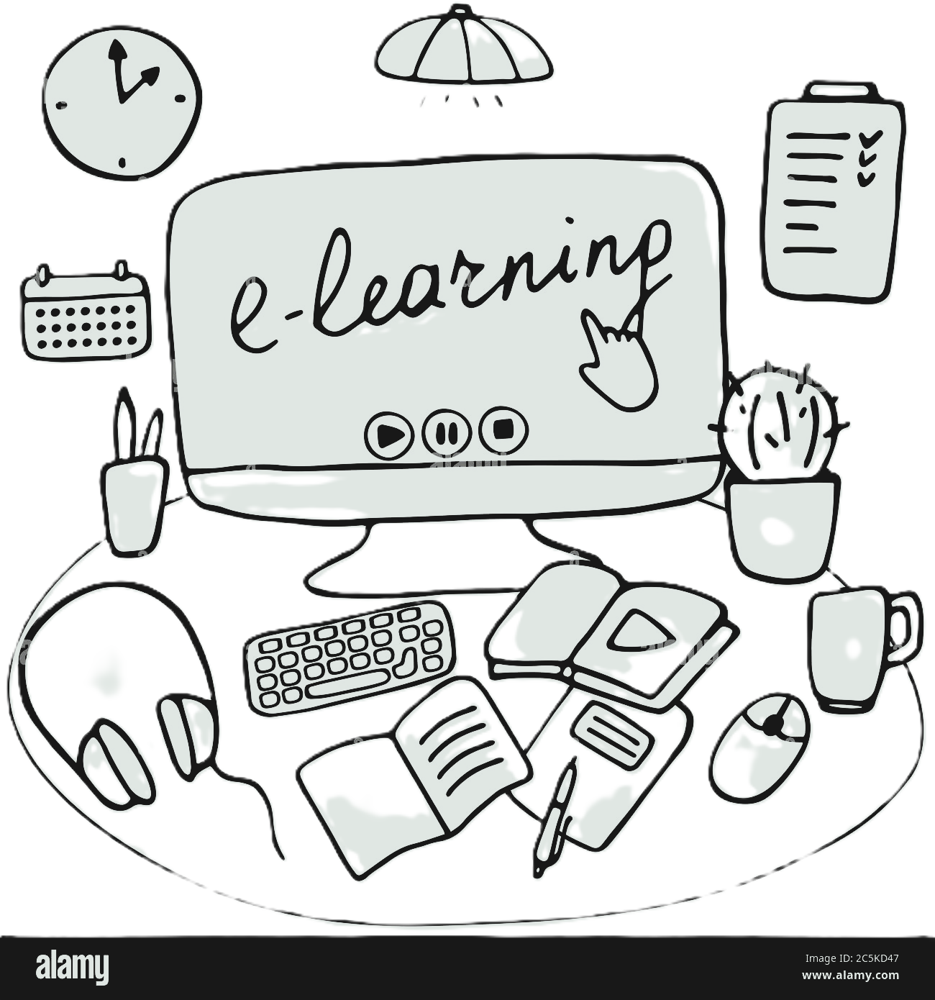

  

  <samp><b>Full-Stack Software Engineer · AI/ML &amp; NLP Developer · BA &amp; QA Enthusiast</b></samp>

  <samp>Undergraduate pursuing a B.Sc. (Hons) in Computing &amp; Information Systems at the Sabaragamuwa University of Sri Lanka (SUSL), with freelance software development experience since 2023.</samp>

---

  <picture>
    <source media="(prefers-color-scheme: dark)" srcset="./dark.svg" />
    <source media="(prefers-color-scheme: light)" srcset="./light.svg" />
    
  </picture>

### <samp>~/about</samp>

<table frame="void" rules="none">
  <tr>
    <td width="66%" valign="top">
      

        <samp>I am genuinely passionate about building practical software and AI solutions that turn everyday problems into clear, dependable tools. Whether I am diving into a new codebase, learning an unfamiliar stack, or moving between full-stack engineering, AI/ML and NLP, business analysis, and quality assurance, I adapt quickly and love learning by doing.</samp>
      

      <ul>
        <li><samp>🚀 <b>Passionate &amp; Eager to Learn:</b> Always curious about emerging technologies, AI/ML workflows, and modern tools—quick to pick up new concepts and excited to grow alongside a strong engineering team.</samp></li>
        <li><samp>🔄 <b>Adaptable &amp; Leadership:</b> Experienced in stepping up as project manager and team collaborator across academic, hackathon, and freelance builds, adjusting smoothly as priorities and requirements shift.</samp></li>
        <li><samp>💡 <b>Ownership &amp; Clarity:</b> Focused on understanding real user needs, structuring clean workflows, and verifying quality so features work reliably in practice.</samp></li>
        <li><samp>🎻 <b>Hobby — Visharada in Violin:</b> Earning my Visharada in violin performance is a cherished personal hobby that shaped my discipline, patience, attentive listening, and creative expression.</samp></li>
      </ul>
    </td>
    <td width="34%" align="center" valign="middle">
      
    </td>
  </tr>
</table>

### <samp>~/contributions</samp>

<h2 align="center"><samp>GitHub Contributions</samp></h2>

  <picture>
    <source
      media="(prefers-color-scheme: dark)"
      srcset="https://raw.githubusercontent.com/HiruniYasoda/github-snake/output/github-snake-dark.svg"
    />
    <source
      media="(prefers-color-scheme: light)"
      srcset="https://raw.githubusercontent.com/HiruniYasoda/github-snake/output/github-snake.svg"
    />
    
  </picture>

---

### <samp>~/connect</samp>

<ul>
  <li><samp><b>Portfolio:</b> <a href="https://yasodasethmini.com">yasodasethmini.com</a></samp></li>
  <li><samp><b>Video Resume:</b> <a href="https://www.youtube.com">YouTube Showcase</a></samp></li>
  <li><samp><b>Community &amp; Arts:</b> Team Idea Igniters (Hackathon Finalist &amp; Runner-Up); Visharada in Violin Performance.</samp></li>
</ul>
